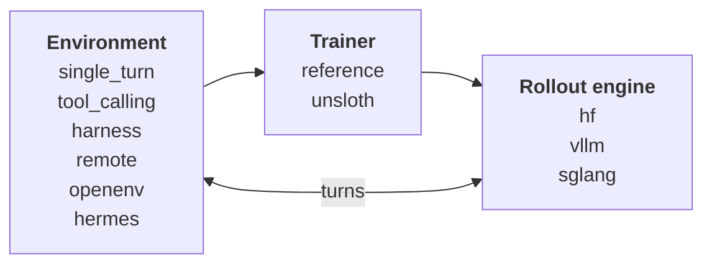

# monorl

[](https://github.com/ysjprojects/monorl/actions/workflows/ci.yml)

**One RL harness, every framework.** monorl trains language models with reinforcement learning
from one config and one orchestrator. It bridges the frameworks you already use
([vLLM](https://github.com/vllm-project/vllm), [SGLang](https://github.com/sgl-project/sglang),
[verl](https://github.com/verl-project/verl), [TRL](https://github.com/huggingface/trl),
[NeMo-RL](https://github.com/NVIDIA-NeMo/RL), [Unsloth](https://github.com/unslothai/unsloth),
[OpenEnv](https://github.com/openenv/OpenEnv) and
[Hermes Agent](https://github.com/NousResearch/hermes-agent)) with **versioned monkeypatches and
adapters instead of forks**.

A run is one `RunConfig` YAML. The same schema describes a GRPO run on a laptop CPU with a 135M
model and a multi-node run compiled to verl, NeMo-RL or TRL.



Environments produce episodes from the policy's turns, the trainer updates the policy (`grpo`,
`dapo`, `rloo`, `reinforce`, `ppo` or `sft`), and its weights are synced back to the rollout
engine. The orchestrator runs this loop itself, or hands the same config to a pipeline backend
(`trl`, `verl`, `nemo_rl`) that runs its own.

## Highlights

**Design**

- **One config.** `RunConfig` (model, data, algorithm, rollout, trainer, rewards, env, cluster,
  logging) is the whole product: recipes serialise it, the web UI renders it, adapters compile it
  into verl Hydra trees, NeMo-RL YAML or a TRL `GRPOConfig`.
- **Pluggable at the seams.** Rollout engines (`hf`, `vllm`, `sglang`), trainers (`reference`,
  `unsloth`), pipeline backends (`trl`, `verl`, `nemo_rl`), rewards, data sources and
  environments talk through `monorl.core.interfaces`; the orchestrator never imports a framework.
- **Patches, not forks.** Each upstream modification is a `Patch` with a target, a version gate
  and a verification hook; pins live in [`third_party/pins.toml`](third_party/pins.toml)
  ([docs](docs/PATCHING.md)).
- **Tested where it can run.** What runs on a laptop is tested on a laptop and in CI (CPU,
  Python 3.12). GPU-only paths are written against pinned upstream APIs, version-gated,
  unit-tested with fakes and skipped, never stubbed, when the framework is absent.
  [Status](#status) lists what ran for real.

**Agents and environments**

- **Train any agent.** With `env.type: harness` an external agent program (an OpenAI- or
  Anthropic-SDK script, an agent framework, an agent CLI) is the environment. monorl serves the
  policy being trained over the OpenAI chat-completions, OpenAI Responses and Anthropic Messages
  APIs, streaming and image inputs included, and records every call with its exact token ids and
  logprobs ([docs](docs/GATEWAY.md)).
- **Sandboxed episodes, benchmark tasks as data.** `env.params.sandbox: {backend: docker}` runs
  each episode's agent and verifier in their own container, and a directory of tasks in the
  Harbor / Terminal-Bench format is a dataset ([docs](docs/SANDBOX.md)).
- **Environments in any language.** The MEP/1 wire protocol (JSON over stdio or HTTP) lets Go,
  C++ or Python environments plug in; SDKs and examples ship under [`envs/sdk`](envs/sdk)
  ([docs](docs/ENV_SDK.md)).
- **Survives real agents.** A failed episode is retried or left out of the batch instead of
  failing the run (`env.retries`, `env.max_failed_frac`). Every episode stays inside a context
  budget (`rollout.max_context_tokens`): generation is capped to the room left, and an agent
  behind the gateway gets `context_length_exceeded` so it can compact its history.

**Training multi-turn policies**

- **Token-contiguous episodes.** Prompts are continued token-in/token-out instead of
  re-rendering the chat, and an episode trains as one sequence per token-contiguous chain of
  turns, so compaction, sub-agents and re-rendered chats lose no tokens. `loss_agg: rollout`
  weighs every episode equally.
- **Credit where it is due.** `credit_assignment: turn` credits each turn with the return from
  that turn on, and `algorithm.name: ppo` trains a value head next to the policy for turn-level
  GAE ([docs](docs/CREDIT_ASSIGNMENT.md)).
- **Async rollouts with off-policy corrections.** `rollout.async_steps_ahead: N` generates ahead
  of the trainer; stale batches are corrected with decoupled PPO, truncated importance weights,
  a ratio mask and score centering ([docs](docs/OFF_POLICY.md)).
- **Multi-token prediction.** For models that ship MTP layers (DeepSeek-V3, GLM, Step, Mellum
  and others) `model.mtp` drafts with them during rollouts without changing what is sampled,
  trains them next to the policy, and keeps them in weight sync, checkpoints and the exported
  model ([docs](docs/MTP.md)).
- **Pipelines and distillation.** `monorl pipeline` chains SFT, RL, rejection sampling and eval
  stages, so a run can sample agent episodes, keep the solved ones and fine-tune on every policy
  turn of them (`algorithm.sft_turns: all`) ([docs](docs/PIPELINES.md)).

**Scale and tooling**

- **Distributed when you need it.** Colocated (the engine sleeps during the optimizer step) or
  disaggregated GPU placement, Ray worker groups, and in-process, CUDA-IPC, NCCL-broadcast or
  checkpoint weight sync ([docs](docs/DISTRIBUTED.md)).
- **Data from disk, S3 or the Hub.** Local files, `hf://` datasets and `s3://` objects
  (credentials from the environment), with column mapping and image columns
  ([docs](docs/DATA.md)).
- **See what the agent did.** Every saved rollout carries its full transcript; runs report
  success rate, pass@k and turns per episode, to `metrics.jsonl` and optionally W&B and
  TensorBoard ([docs](docs/RUNS.md)).
- **Low-code web UI.** Pick a model and a dataset, preview and map columns, launch runs and
  pipelines, and read episodes turn by turn ([docs](docs/WEB_UI.md)).
- **Size a run first.** `monorl bench` measures rollout tokens/s, environment episodes/s and
  weight-sync time and prints a placement plan.

## Quickstart

Needs Python 3.12 and [uv](https://docs.astral.sh/uv/). Optional: Node 24 and pnpm for the web
UI, Go and clang++ for the example environments, Docker for sandboxed episodes.

```bash
make install                # .venv + monorl[dev,trl,distributed,rewards,openenv,hermes]
source .venv/bin/activate
monorl doctor               # what is installed, which patches apply, what is registered

# train: GRPO on GSM8K with SmolLM2-135M, CPU only, ~minutes
monorl train --config configs/recipes/grpo_gsm8k_smollm_cpu.yaml --set trainer.max_steps=5

# web UI
make web                    # build web/dist once
monorl serve                # http://127.0.0.1:8000, opens a browser tab

# look at data before training
monorl data inspect hf://openai/gsm8k --config-name main --limit 3
AWS_ENDPOINT_URL=http://localhost:9000 monorl data inspect s3://my-bucket/data/train.jsonl
```

A run writes `~/.monorl/runs/<run_name>/`: `config.yaml`, `status.json`, `metrics.jsonl`,
`trajectories.jsonl`, `run.log`, `checkpoints/` and the exported model in `final/`. `--resume`
continues from the latest checkpoint.

GPU engines and backends are extras (`.[vllm]`, `.[sglang]`, `.[verl]`; `.[multimodal]` for
images). Unsloth gets its own venv (`make install-unsloth`) and NeMo-RL is a git checkout
(`NEMO_RL_HOME`); see [`docs/BACKENDS.md`](docs/BACKENDS.md).

## Recipes

Every recipe in [`configs/recipes`](configs/recipes) is a complete config. `monorl recipes list`
describes them, `monorl recipes show NAME` prints one.

Runs on a laptop (CPU, SmolLM2-135M unless stated):

| Recipe | What it shows |
|---|---|
| `grpo_gsm8k_smollm_cpu` | GRPO on GSM8K with the `hf` engine and the reference trainer. Start here. |
| `sft_coldstart_cpu` | Supervised fine-tuning on GSM8K's worked solutions |
| `r1_sft_grpo_loop_cpu` | Pipeline in the style of DeepSeek-R1: SFT, GRPO, rejection sampling, SFT, GRPO, greedy eval |
| `distill_tool_calling_cpu` | Pipeline with Qwen2.5-0.5B: sample tool-calling episodes, keep the solved ones, SFT on every turn, eval |
| `grpo_harness_calc_cpu` | An external tool-using agent as the environment, through the capture gateway |
| `grpo_harness_tasks_docker_cpu` | Harbor-format task directories, every episode in its own Docker container (needs Docker) |
| `grpo_remote_env_go_wordle` | A Go environment over MEP/1 stdio (needs `make envs`) |
| `grpo_remote_env_cpp_number_guess` | A C++ environment over MEP/1 http (needs `make envs`; start the server first) |
| `trl_grpo_cpu` | TRL's `GRPOTrainer` as the pipeline backend |
| `grpo_mtp_tiny_cpu` | MTP drafting and training with a tiny random model (build it with `scripts/dev/tiny_mtp_model.py`) |
| `openenv_example` | An OpenEnv server as a multi-turn environment (start the server first) |
| `s3_dataset_example` | Training from a JSONL file on S3 or an S3-compatible store |

Needs GPUs:

| Recipe | What it shows |
|---|---|
| `grpo_gsm8k_qwen_vllm_1gpu` | GRPO with Qwen2.5-1.5B on one GPU: vLLM rollouts with sleep mode, LoRA in the reference trainer |
| `dapo_math_vllm_8gpu_colocated` | DAPO with Qwen2.5-7B, 8 GPUs colocated: vLLM TP=2 x DP=4, CUDA-IPC weight sync |
| `grpo_tool_calling_sglang` | Multi-turn tool calling with SGLang as the engine (prefix caching) |
| `hermes_agent_example` | A Hermes Agent tool loop as the environment, vLLM rollouts |
| `verl_grpo_gsm8k_8gpu` | The config compiled to verl (FSDP actor, vLLM rollout) on a Ray cluster |
| `nemo_rl_grpo_math` | The config compiled to NeMo-RL, 2 nodes x 8 GPUs |
| `r1_sft_grpo_loop_8gpu_vllm` | The six-stage R1 pipeline with Qwen2.5-7B on 8 GPUs |

## Bring your own agent or environment

### An agent program

Any program that calls an OpenAI- or Anthropic-compatible API can be the environment. The harness
starts it once per episode with `OPENAI_BASE_URL`, `ANTHROPIC_BASE_URL` and the path of the task
(`MONORL_TASK_FILE`) in its environment, so an unmodified SDK client talks to the policy being
trained:

```python
# agent/my_agent.py
import json, os
from openai import OpenAI

task = json.load(open(os.environ["MONORL_TASK_FILE"]))
reply = OpenAI().chat.completions.create(
    model=os.environ["MONORL_MODEL"], messages=task["messages"]
)
print(reply.choices[0].message.content)
```

```yaml
env:
  type: harness
  params:
    command: ["{python}", "my_agent.py"]
    workdir: {template: ./agent}     # copied into each episode's fresh working directory
```

Score the episode with `rewards:` functions, a `verifier` command, or rewards the agent posts
itself. `grpo_harness_calc_cpu.yaml` is a complete recipe with a tool-using agent; tools, the
Responses and Messages APIs and verifiers are in [`docs/GATEWAY.md`](docs/GATEWAY.md), containers
and task directories in [`docs/SANDBOX.md`](docs/SANDBOX.md).

### An environment in Go

```go
package main

import (
    "context"
    "strings"

    "github.com/monorl/envsdk/mep"
)

// One turn: reward 1 when the policy's answer equals the dataset row's reference.
type env struct{ answers *mep.EpisodeStore[string] }

func (e *env) Spec() mep.Spec {
    return mep.Spec{Name: "exact", Version: "1", MaxTurns: 1, ParallelEpisodes: 32}
}

func (e *env) Reset(
    _ context.Context, id string, s mep.Sample, _ *int64,
) (mep.ResetResult, error) {
    answer, _ := s.Reference.(string)
    e.answers.Put(id, answer)
    return mep.ResetResult{Messages: s.Messages}, nil
}

func (e *env) Step(_ context.Context, id string, a mep.Action) (mep.StepResult, error) {
    answer, _ := e.answers.Get(id)
    reward := 0.0
    if strings.TrimSpace(a.Text) == answer {
        reward = 1
    }
    return mep.StepResult{Reward: reward, Done: true}, nil
}

func (e *env) Close(id string) error { e.answers.Delete(id); return nil }

// Every SDK server takes --transport stdio|http and --addr host:port.
func main() { mep.Main(&env{answers: mep.NewEpisodeStore[string]()}) }
```

Saved as `envs/sdk/go/examples/exact/main.go`, it builds with the bundled examples:

```bash
make -C envs go                                         # builds envs/bin/go-exact
monorl env check --command envs/bin/go-exact --turns 1  # spec, health, reset, step, close
```

then point a recipe at it:

```yaml
env:
  type: remote
  params: {transport: stdio, command: ["envs/bin/go-exact"], parallel: 32}
rewards: []            # the environment's per-turn reward is used
```

`make envs` builds the bundled examples (`go-arith`, `go-wordle`, `go-gridworld`, `cpp-arith`,
`cpp-number_guess`) into `envs/bin`; `configs/recipes/grpo_remote_env_*.yaml` use them. The C++
SDK is header-only (`envs/sdk/cpp/include/mep/mep.hpp`) and serves the same protocol
([`docs/ENV_SDK.md`](docs/ENV_SDK.md)).

## CLI

| Command | What it does |
|---|---|
| `monorl train` | Run a training job: `--config PATH` (a `RunConfig` YAML), `--set key.path=value` to override a field, `--run-dir DIR`, `--resume` from the latest checkpoint |
| `monorl pipeline` | Run a multi-stage pipeline (SFT, RL, rejection sampling and eval stages). Same options; `--resume` skips the stages that already succeeded |
| `monorl serve` | Web UI and API (`--host`, `--port`, `--no-open`, `--reload`) |
| `monorl doctor` | System, frameworks, patches and registered components (`--json`) |
| `monorl bench` | `rollout`, `env`, `sync`, `plan`: size a run by tokens/s, episodes/s, sync time and a placement plan |
| `monorl patches` | `list`, `status [FRAMEWORK]`, `apply FRAMEWORK`: inspect and apply the patchsets |
| `monorl data inspect URI` | Preview a dataset and the samples built from it (`--limit`, `--split`, `--config-name`, `--json`) |
| `monorl env check` | Drive a MEP/1 server (`--command CMD...` or `--url URL`) through spec, health, reset, step and close |
| `monorl env serve TYPE` | Expose a Python environment as a MEP/1 server (`--transport stdio\|http`, `--port`) |
| `monorl recipes` | `list`, `show NAME`: browse the bundled recipes |

`python -m monorl.cli ...` is equivalent (the web server launches runs that way); `python -m monorl.bench`
is the same as `monorl bench`.

## Support matrix

The native loop: rollout engines and trainers behind monorl's orchestrator.

| | hf + reference | vLLM | SGLang | Unsloth |
|---|---|---|---|---|
| Role | engine + trainer | engine | engine | trainer |
| Pin | transformers 5.22 | 0.33.0 | 0.5.23 | 2026.10.11 |
| Tested here | real, CPU | fakes | fakes | fakes |
| RL algorithms | GRPO, DAPO, RLOO, REINFORCE, PPO (value head) | any (engine) | any (engine) | GRPO, DAPO, RLOO, REINFORCE, PPO (value head) |
| Per-turn credit (`credit_assignment: turn`) | yes | any (engine) | any (engine) | yes |
| SFT (`algorithm.name: sft`) | yes | n/a | n/a | yes |
| SFT on every assistant turn (`sft_turns: all`) | yes | n/a | n/a | yes |
| Images (VLM) | yes | yes | yes | text only |
| LoRA | yes | n/a | n/a | yes |
| MTP layers (`model.mtp`) | draft, train, export | draft, drafter weight sync | draft, draft weight sync | – |
| Multi-turn / tools | yes | yes | yes (prefix cache) | yes |
| External agent as env (`harness`, Docker sandbox, task directories) | yes | yes | yes | yes |
| Off-policy corrections (`algorithm.off_policy`) | decoupled PPO, truncated IS weights, ratio mask, score centering | yes (top-k for score centering) | yes (top-k for score centering) | yes |
| Colocated (sleep) | n/a | yes | yes | – |
| Disaggregated / Ray | yes | yes | yes | – |
| Weight sync | inprocess | cuda_ipc, broadcast, checkpoint | cuda_ipc, broadcast, checkpoint | inprocess |
| Patched | – | yes | yes | – |

Pipeline backends: the same config compiled for another framework's loop.

| | TRL | verl | NeMo-RL |
|---|---|---|---|
| Pin | 1.17.1 | 0.9.1 | v0.7.0 (git) |
| Tested here | real, CPU | fakes | fakes |
| RL algorithms | GRPO, DAPO | GRPO, DAPO, RLOO, REINFORCE, PPO (own critic) | GRPO, DAPO, RLOO, REINFORCE |
| Per-turn credit | – | – | – |
| SFT | `SFTTrainer` | `sft_trainer_ray` | `run_sft.py` |
| SFT on every assistant turn | `assistant_only_loss` | always | yes |
| Images (VLM) | yes | yes | text only |
| LoRA | yes | yes | yes |
| MTP layers | – | draft only | draft; train with Megatron |
| Multi-turn / tools | monorl episodes as `rollout_func` | `tool_calling` env only | env bridge (the env's reset prompt is not forwarded) |
| External agent as env | yes | – | – |
| Off-policy corrections | mapped to TRL's vLLM IS correction | mapped to `rollout_correction` | mapped to `loss_fn` IS options |
| Colocated (sleep) | vLLM colocate | yes | yes |
| Disaggregated / Ray | vLLM server | yes | yes |
| Weight sync | TRL-native | verl-native | NeMo-native |
| Patched | yes | yes | yes |

Environments: `single_turn`, `tool_calling` and `harness` are built in; three more connect
external ones:

| | MEP/1 (`remote`) | OpenEnv (`openenv`) | Hermes Agent (`hermes`) |
|---|---|---|---|
| What it connects | an environment server in Go, C++ or Python | an OpenEnv server | Hermes Agent's tool loop |
| Pin | – | 0.3.0 | 0.19.0 |
| Tested here | real, CPU | real, CPU | real, CPU |
| Multi-turn / tools | yes | yes | yes |
| Images | image refs | text only | text only |

Details per backend: [`docs/BACKENDS.md`](docs/BACKENDS.md).

## Status

What ran for real on macOS (CPU, Python 3.12), with SmolLM2-135M on the `hf` engine unless
stated. `make test` and `make lint` pass there; CI runs the suite on Linux without its `slow`,
`network` and `gpu` tests.

| Area | Ran for real |
|---|---|
| Training | `grpo_gsm8k_smollm_cpu.yaml` end to end (`scripts/dev/smoke.sh`); runs with `credit_assignment: turn` and with `ppo` (value head, turn-level GAE) |
| Pipelines | The six-stage `r1_sft_grpo_loop_cpu.yaml` from the CLI, through a SIGTERM and `--resume`; the pipeline that samples episodes, runs SFT on every turn of them and evaluates, end to end |
| Environments | The Go wordle environment through `grpo_remote_env_go_wordle.yaml`, over stdio and over http against the four replicas of the compose stack; `tool_calling` episodes with real tool calls, each trained as one token-contiguous sequence |
| External agents | A tool-using agent through the capture gateway on the native loop and on the TRL backend, also with a side conversation (two threads, two training sequences per episode); agents written with the OpenAI SDK (Responses API, `previous_response_id`) and the Anthropic SDK (tool use, streamed final turn), with token-contiguous episodes; an image-sending agent training a tiny random Qwen2-VL |
| Failures and context | A run whose agent crashes on some episodes finishes with those episodes left out or retried; a context budget ends episodes instead of truncating them in training |
| Sandbox | Harness episodes in real Docker containers (agent and verifier inside, reward from the verifier, containers removed); `grpo_harness_tasks_docker_cpu.yaml` on its Harbor-format example tasks |
| Async rollouts | `rollout.async_steps_ahead: 2` with decoupled PPO, importance weights and a ratio mask, and with score centering |
| MTP | A tiny random Mellum with one MTP layer (`grpo_mtp_tiny_cpu.yaml`): rollouts drafted by the layer, the layer trained and pushed back every step (`mtp/accept_rate` from 0 to 0.17 on sampled rollouts and 0.41 in greedy evaluation, over 16 steps), and the export loads with it in transformers |
| Web UI | Launches a pipeline on the real server and streams its stage table, charts, log and trajectories; the transcript viewer and the wizard's fields for everything above |
| Containers | `docker/Dockerfile.{cpu,envs}` build, `docker compose up` comes up healthy, and the five example environments pass `monorl env check` from the container |

Exercised against fakes only: the GPU backends (vLLM, SGLang, Unsloth, verl, NeMo-RL) and their
images, Docker Engine on Linux (only Docker Desktop was run), MTP drafting on vLLM and SGLang,
MTP models other than Mellum, and the value head on Unsloth and on several Ray trainer ranks.
`pytest -m gpu` runs the real-framework tests on a CUDA machine.

## Docs

[`docs/README.md`](docs/README.md) is the index, by section of the config. By topic:

- **The config**: [every field](docs/CONFIG.md) · [backends](docs/BACKENDS.md) ·
  [data](docs/DATA.md) · [algorithms](docs/ALGORITHMS.md) · [rewards](docs/REWARDS.md) ·
  [environments](docs/ENVIRONMENTS.md)
- **Agents and environments**: [capture gateway, `env.type: harness`](docs/GATEWAY.md) ·
  [Docker sandbox and task directories](docs/SANDBOX.md) ·
  [Go and C++ SDKs, MEP/1](docs/ENV_SDK.md)
- **Training**: [credit assignment](docs/CREDIT_ASSIGNMENT.md) ·
  [off-policy corrections](docs/OFF_POLICY.md) · [multi-token prediction](docs/MTP.md) ·
  [pipelines](docs/PIPELINES.md)
- **Running**: [runs, metrics, checkpoints](docs/RUNS.md) ·
  [distributed](docs/DISTRIBUTED.md) · [web UI](docs/WEB_UI.md)
- **Internals**: [architecture and contracts](docs/ARCHITECTURE.md) ·
  [patching](docs/PATCHING.md) · [code map](src/monorl/README.md) ·
  [contributing](CONTRIBUTING.md)

## Layout

```
src/monorl/
  core/ config/              types, interfaces, registry · RunConfig, PipelineConfig
  orchestrator/ pipeline/    training loop, episodes, SFT · multi-stage pipelines
  rollout/ trainer/ mtp.py   hf engine · reference trainer · MTP layers
  algorithms/ rewards/ data/
  envs/ gateway/             environments, MEP/1, Docker sandbox · capture gateway
  distributed/ bench/        placement, Ray, weight sync · throughput tooling
  adapters/                  vllm, sglang, trl, unsloth, verl, nemo_rl, openenv, hermes
  patching/ server/ cli/ doctor.py
envs/sdk/{go,cpp}/           environment SDKs and examples
web/                         Vite + React UI
configs/recipes/             example run and pipeline configs
examples/sandbox/            example task directories and a shell agent
docker/ scripts/ tests/
third_party/pins.toml        upstream pins; scripts/vendor.py clones the sources here
```

## Development

[`CONTRIBUTING.md`](CONTRIBUTING.md) has the setup, the checks, the testing rules and the
conventions; [`src/monorl/README.md`](src/monorl/README.md) maps the code.

```bash
make test-fast     # pytest -m 'not slow and not network'
make test          # everything (downloads tiny models, trains for a few steps on CPU)
make lint          # ruff check + format check
make envs          # Go and C++ example environments into envs/bin
scripts/vendor.py --list           # the pins and what is cloned
scripts/vendor.py --fetch vllm     # clone a pinned upstream source (or `all`)
```

## Containers and CI

```bash
scripts/dev/bootstrap.sh     # .venv (uv, Python 3.12), example envs in envs/bin, web/dist
scripts/dev/smoke.sh         # CPU end to end: 2-step GRPO run, then `monorl serve` probes
docker compose up --build    # UI on :8000 and four `env-wordle` MEP/1 replicas
docker compose --profile gpu up ray-head    # Ray head on the vLLM image (NVIDIA runtime)
```

Inside the compose stack a run addresses the four replicas one by one, with
`http://monorl-env-wordle-1:8080` to `http://monorl-env-wordle-4:8080` in `env.params.urls`; from
the host they are on `localhost:8081` to `localhost:8084`.

Images: `docker/Dockerfile.{cpu,vllm,sglang,verl,envs}`. `.github/workflows/ci.yml` runs ruff
(check + format) and pytest (CPU), `go vet`/`go test`/example builds for `envs/sdk/go`, the C++ SDK
build, the web build and lint, the MEP/1 conformance tests, hadolint, and builds the `envs` and
`cpu` images.

## License

[Apache-2.0](LICENSE).
